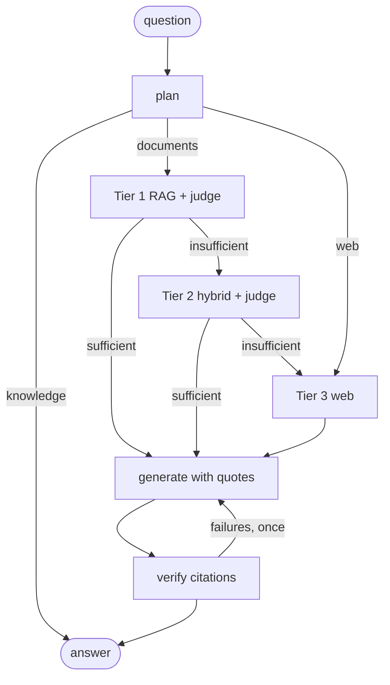

# Adaptive RAG: a research-style answer engine with verified citations

Ask a question. The system climbs an escalation ladder and stops at the first tier whose evidence is enough:

| Tier | What it does | When |
|---|---|---|
| 0 · own knowledge | the model answers directly, labelled *not verified* | the question is not about your documents, not time-sensitive, reliably known |
| 1 · RAG | dense (embedding) search over your documents | first try for anything about your documents |
| 2 · hybrid | BM25 + dense for the question and 2-3 rewritten/decomposed queries, reciprocal-rank fusion, cross-encoder rerank, relevance filter, dedupe | an LLM judge reasoned step by step that tier 1 evidence is not enough |
| 3 · web | DuckDuckGo (or Tavily with a key), top pages fetched and reranked | the documents still fall short, or the question needs fresh information |

Every answer is grounded: each claim carries `[n]`, each citation names its source chunk and a **verbatim quote**,
and a deterministic checker confirms the quote really is in that source (PDF: file + page, web: URL). Failed
citations trigger one regeneration with the failures as feedback; anything still unverified is flagged, never hidden.

Two modes, picked per question in the UI ("Step by step" | "Agent") or with `"mode"` in the API body:

- **Step by step (default, `ladder`)**: the fixed ladder above. After each document tier an LLM judge reasons about the
  evidence and sorts every missing part into "search the documents deeper" or "only on the web"; when the evidence is
  enough, the judge writes the answer in the same call. Fastest and most accurate: 20/20, median 7.6 s on the eval.
- **Agent (`agent`)**: the model gets the pieces as tools (`search_documents` quick or deep, `search_web`) and decides
  each round what to call; the calls of a round run in parallel (up to 2 search rounds), then it answers. Same quote
  verification. Slower on simple questions, strongest on multi-part ones ("megapixels + who makes them + how to
  replace them": specs from the web and the procedure pages from the manual in one answer).



## No API key needed

Two ways to run it, neither needs a key:

1. **Inside your harness (MCP).** Claude Code, Antigravity (agy) or GitHub Copilot use their own model to follow the
   research protocol; this repo's MCP server only does retrieval, web search and citation checking, all local.
   Setup: [docs/HARNESS.md](docs/HARNESS.md). In Claude Code, open this repo and run
   `/mcp__adaptive-rag__adaptive_research <question>`.
2. **Standalone (API + UI).** The pipeline calls an LLM through `LLM_MODEL`: a CLI you are logged into
   (`cli:claude` default, `cli:agy`, `cli:copilot`, all run text-only with no tools) or BYOK through LangChain
   (`openai:gpt-4o-mini`, `anthropic:claude-sonnet-4-5`, `google_genai:gemini-2.5-flash`, `ollama:llama3.1`, with the
   provider package and key). A comma-separated value is a fallback chain.

Embeddings (`BAAI/bge-small-en-v1.5`) and the reranker (`ms-marco-MiniLM-L-6-v2`) run locally via fastembed
(~150 MB, downloaded once into `data/models`).

## Quick start

```bash
uv venv .venv --python 3.13
uv pip install --python .venv/Scripts/python.exe -r requirements.txt   # .venv/bin/python on macOS/Linux

# API + chat UI: open http://127.0.0.1:8000 (API docs at /docs)
.venv/Scripts/python.exe -m uvicorn src.main:app
```

Upload a PDF/TXT/MD in the sidebar, then ask. While the answer is researched, every step appears live as a card
(plan, each tier's retrieved chunks and the judge's step-by-step verdict, web results, generation, citation check).
The answer's `[n]` chips show the verbatim quote and its page or link; sources are marked ✓ verified or ⚠.
Every answered turn is appended to `data/conversations.jsonl` (question, answer, citations, trace) for later review.

### API

| Method | Path | Body | Returns |
|---|---|---|---|
| POST | `/rag/query` | `{"query": "...", "session_id": "..."}` | `{answer, rendered, citations, tier, trace, verified, seconds, session_id}` |
| POST | `/rag/query/stream` | same | server-sent events: `step` per finished node (plan, rag, hybrid, web, generate, verify), then `final` |
| GET | `/rag/info` | | `{llm, web}` backends in use |
| POST | `/rag/documents/upload` | multipart `file`, optional header `X-Description` | `{status, document: {doc_id, name, pages, chunks, status}}` |
| GET | `/rag/documents` | | indexed documents |

Follow-up questions work: the planner rewrites them into standalone questions from the session history.

## Configuration (`.env` or environment)

| Variable | Default | Meaning |
|---|---|---|
| `LLM_MODEL` | `cli:claude` | LLM backend chain (see above) |
| `CLI_MODEL` | per CLI (`haiku`, `gemini-3.8-flash-medium`, `auto`) | model flag for `cli:*` |
| `TAVILY_API_KEY` | empty | use Tavily instead of the free DDGS search (free tier: 1,000 searches/month). Recommended: the free engines rate-limit busy machines, so a web step takes ~8-10 s (search ~3 s per pass, page fetch ~1.5 s, rerank ~2 s) and sometimes finds nothing |
| `MONGO_URL` | empty | persist chat history in MongoDB (`pip install motor`); default is in-memory |
| `DATA_DIR` | `./data` | SQLite index, uploads, model cache, conversation log |

## Layout

```
src/
  rag/store.py         SQLite index: documents, page-level chunks, embeddings, FTS5 (BM25); dense/keyword/hybrid search, rerank
  rag/web.py           web tier: search, fetch pages, rerank passages
  rag/graph_builder.py the LangGraph ladder: plan -> rag -> hybrid -> web -> generate -> verify
  rag/citations.py     deterministic quote verification + Sources rendering
  llms/llm.py          CLI (claude/agy/copilot) and BYOK backends behind ask()/ask_json()
  config/prompts.yaml  plan, judge, generate, regenerate prompts
  mcp_server.py        MCP server for Claude Code / agy / Copilot
  api/, memory/, db/   FastAPI routes, chat history (in-memory or MongoDB)
web/                   chat UI (static HTML/CSS/JS served by the API, streams the reasoning steps)
eval/                  iPhone manual test set, sources, ground-truth checker, REPORT.md
scripts/run_eval.py    end-to-end eval
tests/                 offline unit tests (pytest)
```

## Tests and eval

```bash
.venv/Scripts/python.exe -m pytest -q          # offline: store, citations, graph ladder, API, MCP stdio
.venv/Scripts/python.exe eval/check_questions.py  # ground truth: each expected page really contains the answer
.venv/Scripts/python.exe scripts/run_eval.py      # live end-to-end on the iPhone manuals -> eval/REPORT.md
```

The eval uses two Apple manuals (not committed, see [eval/SOURCES.md](eval/SOURCES.md) to download):
the iPhone User Guide (196 pages) and the iPhone 16 repair manual (214 pages), with 20 questions across all tiers.

Latest runs (2026-11-06, `cli:claude` = Claude Haiku via the CLI, no key):

| Mode | Passed | Citations verified | Expected manual page cited | Median per answer | Report |
|---|---|---|---|---|---|
| Step by step (ladder) | **20/20** | 37/37 | 14/14 | 7.6 s | [eval/REPORT.md](eval/REPORT.md) |
| Agent | 18/20 | 63/63 | 12/14 | 10.2 s | [eval/REPORT_agent.md](eval/REPORT_agent.md) |

The agent's two misses cited a neighbouring page (p. 186 for the force-restart steps on p. 187) and missed the
part-numbers table, which the ladder's fused rerank order finds.

Routing rules learned from real use: well-known facts ("who makes the iPhone") are answered from model knowledge even
when they touch the documents' subject; after Tier 1 the judge sorts each missing part into "search the documents
deeper" or "only on the web", so a mixed question (camera megapixels + who makes them + how to replace them) gets the
specs from the web and the procedure pages from the manual, and an off-topic one skips Tier 2. Retrieval reads on
three chunks past each top hit, because procedure pages after a section's first page rarely repeat its title.
`cli:agy` and `cli:copilot` give the same grounded answers but slower (each call starts a fresh CLI: ~1.5-3 min per
answer against ~13 s for the pooled claude sessions).

Harness mode was checked with `claude -p ... --mcp-config .mcp.json`: Claude Code searched the repair manual through the
MCP tools, verified its quotes with `verify_citations` and answered with page citations, without any backend LLM.

Note: `.mcp.json` uses the Windows venv path `.venv/Scripts/python.exe`; on macOS/Linux use `.venv/bin/python`.
